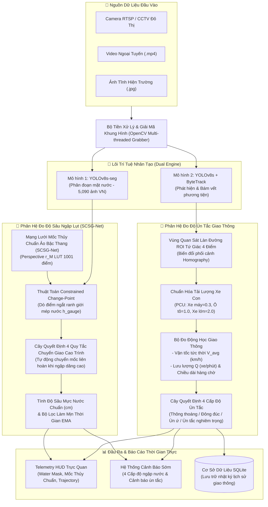

# 🌊 AI-Powered Urban Flood Depth & Traffic Congestion Monitoring System
### *Hệ Thống Trí Tuệ Nhân Tạo Giám Sát Mực Nước Ngập & Mật Độ Giao Thông Đô Thị Thời Gian Thực*

[](https://www.python.org/)
[](https://pytorch.org/)
[](https://github.com/ultralytics/ultralytics)
[-yellow.svg)](https://huggingface.co/spaces/thietnt/AI-Urban-Flood-Traffic-Monitor)
[](LICENSE)

---

## 📌 Giới Thiệu Tổng Quan (Overview)

Hệ thống kết hợp thị giác máy tính và hình học quang học hiện đại (**Dual YOLOv8 + ByteTrack + SCSG-Net**) để giải quyết đồng thời hai bài toán cấp thiết trong quản lý đô thị thông minh:
1. **Đo lường độ sâu ngập lụt theo thời gian thực (centimet):** Sử dụng mô hình phân đoạn mặt nước `YOLOv8s-seg` kết hợp mạng lưới mốc thủy chuẩn ảo đa điểm bậc thang (**SCSG-Net** - chuẩn USGS/ISO) nhằm xác định mực nước chính xác từ camera an ninh sẵn có mà không cần lắp đặt cảm biến ngầm tốn kém.
2. **Giám sát và phân tích ùn tắc giao thông:** Ứng dụng thuật toán theo dõi đa đối tượng **ByteTrack** để đo vận tốc tức thời thực tế (km/h), mật độ xe con quy đổi (**PCU**), chiều dài hàng chờ và tự động phân cấp mức độ ùn tắc giao thông trên từng làn đường.

* 🚀 **Trải nghiệm trực tiếp (Live Demo Cloud ZeroGPU):** [Hugging Face Space](https://huggingface.co/spaces/thietnt/AI-Urban-Flood-Traffic-Monitor)
* 📂 **Mã nguồn chính thức (Official GitHub):** [NguyenThanhThiet87/-AI-Urban-Flood-Traffic](https://github.com/NguyenThanhThiet87/-AI-Urban-Flood-Traffic)
* 🎬 **Video Demo thực tế:** [Google Drive Folder](https://drive.google.com/drive/folders/1fL-NHAd-ckkwjHxJzhM5UuFgKY-9o2hA?usp=sharing)

---

## 🏗️ Kiến Trúc Hệ Thống (System Architecture)



---

## 🔬 Chi Tiết 3 Trụ Cột Kỹ Thuật Cốt Lõi (Core Technical Modules)

### 1. 🌊 Phân Đoạn Mặt Nước Ngập (Flood Boundary Segmentation)

* **Tập dữ liệu đặc thù Việt Nam (5,090 ảnh):**
  * Được thu thập và chuẩn hóa từ camera thực tế tại các điểm ngập lụt đô thị điển hình: Cần Thơ (đường Trần Việt Châu, Võ Văn Kiệt, Nguyễn Đệ), TP.HCM, Hà Nội và vùng lũ ngập tràn Cao Bằng.
  * Đa dạng kịch bản ngoại cảnh: mưa rào lớn, phản chiếu ánh sáng đèn đường ban đêm, nước đục màu phù sa và vũng nước đọng cục bộ.
* **Kiến trúc mô hình YOLOv8s-seg:**
  * Cấu trúc Backbone C2f trích xuất đặc trưng đa tầng kết hợp với Segment Head (Prototype Mask Branch) để tạo mặt nạ nhị phân sắc nét ranh giới tiếp xúc giữa nước và các bề mặt rắn (vỉa hè, cột mốc, mép tường).
  * Chế độ suy luận kích hoạt `retina_masks=True` giúp bảo toàn độ phân giải nguyên bản của mặt nạ nước, tránh hiện tượng răng cưa khi chiếu lên thân mốc thủy chuẩn.

---

### 2. 📏 Đo Độ Sâu Mực Nước Bằng Mạng Lưới Mốc Thủy Chuẩn Ảo (SCSG-Net)

Phân hệ đo độ sâu ngập không phụ thuộc vào phương tiện mà ứng dụng nguyên lý trắc địa thủy văn số dựa trên cọc mốc tham chiếu thực tế:


* **Mô hình phối cảnh phi tuyến $r_M$ Look-Up Table (1,001 điểm):**
  * Do camera giám sát được lắp trên cao nhìn chéo xuống mặt đường, khoảng cách 1 pixel ở chân cọc $P_{bottom}$ ngoài đời thực tương ứng với độ dài centimet nhỏ hơn so với 1 pixel ở đỉnh cọc $P_{top}$ (méo phối cảnh quang học).
  * Hệ thống xây dựng hàm ánh xạ phi tuyến giải tích dựa trên tham số tỷ lệ phối cảnh $r_M \in (0, 1)$ (tính toán từ điểm mốc vật lý giữa thân cọc $H/2$):
    $$d(r) = \Delta H \cdot \frac{r \cdot (1 - r_M)}{r_M \cdot (1 - r) + r \cdot (1 - r_M)}$$
  * Bảng tra cứu **1,001 điểm LUT** ánh xạ trực tiếp từ tọa độ pixel quét dọc thân mốc sang độ cao vật lý centimet chính xác với độ trễ tính toán $O(1)$.
* **Thuật toán Dò điểm ngắt ranh giới (Constrained Change-Point Detection):**
  * Trích xuất dải điểm ảnh (Strip Width: 10–30px) dọc theo trục mốc và phân tích hàm xác suất ngập $P_{water}(y)$.
  * Tích hợp phép kiểm tra độ tin cậy biên đối xứng (**Flank Reliability Test**) để loại trừ bóng đổ, sóng gợn lăn tăn và vật cản ngẫu nhiên (người đi bộ, rác trôi).
* **Mạng lưới mốc bậc thang (Stepped Cascading Staff Gauge Network - SCSG-Net):**
  * Tuân thủ tiêu chuẩn đo thủy văn **USGS TM 3-A7** và **ISO 4373:2022**. Dải đo được phân tầng thành chuỗi nhiều mốc bậc thang nối tiếp nhau dọc theo triền dốc vỉa hè / mép đường (Mốc 1: 0–30 cm, Mốc 2: 25–60 cm, Mốc 3: 50–100 cm).
  * **Cây quyết định 4 quy tắc chuyển giao cao trình tự động:**
    1. Khi nước nằm trong dải đo của Mốc $i$: Sử dụng giá trị đo trực tiếp của Mốc $i$.
    2. Khi nước dâng vượt qua đỉnh Mốc $i$ (Overflow): Hệ thống tự động chuyển giao việc đo đạc sang Mốc $i+1$ ở bậc cao hơn mà không làm gián đoạn dải đo.
    3. Khi nước rút dưới chân Mốc $i$: Trả quyền đo về Mốc $i-1$.
    4. Khi toàn bộ các mốc đều khô: Báo cáo trạng thái an toàn đường khô ráo.
* **Bộ lọc làm mịn thời gian thích ứng (Adaptive Temporal EMA):**
  * Áp dụng bộ lọc Exponential Moving Average trên cửa sổ trượt thời gian thực 2 giây để triệt tiêu dao động rung lắc do sóng nước tạo bởi xe cộ chạy qua.
* **4 Cấp độ cảnh báo ngập lụt đô thị:**
  * 🟢 **Cấp 0 (0 - 5 cm):** Bình thường, đường khô ráo.
  * 🟡 **Cấp 1 (5 - 15 cm):** Ngập nhẹ mép đường, các phương tiện lưu thông bình thường.
  * 🟠 **Cấp 2 (15 - 25 cm):** Ngập vừa nửa bánh xe máy, nguy cơ chết máy với xe gầm thấp.
  * 🔴 **Cấp 3 (> 25 cm):** Ngập sâu nguy hiểm, cảnh báo cấm lưu thông.

---

### 3. 🚦 Giám Sát & Đánh Giá Mức Độ Ùn Tắc Giao Thông (Traffic Analytics Engine)

Phân hệ giao thông hoạt động độc lập nhằm giám sát lưu lượng và đánh giá độ ùn tắc trên làn đường được chỉ định:


* **Theo dõi đa phương tiện (YOLOv8s + ByteTrack):**
  * Phát hiện đồng thời nhiều loại phương tiện đặc trưng đô thị Việt Nam: xe máy, ô tô con, xe tải, xe buýt.
  * Sử dụng thuật toán **ByteTrack** kết hợp bộ lọc Kalman Filter để duy trì liên tục định danh (Track ID), bảo toàn quỹ đạo ngay cả khi phương tiện bị che khuất một phần trong dòng xe đông đúc.
* **Vùng quan sát làn đường ROI tứ giác 4 điểm (Homography Perspective Transform):**
  * Người dùng dễ dàng chấm 4 góc trên ảnh để khoanh vùng đoạn đường hoặc làn đường cần kiểm soát.
  * Thuật toán tự động sắp xếp 4 góc theo thứ tự chuẩn không gian hình học (Top-Left, Top-Right, Bottom-Right, Bottom-Left) và tính toán ma trận chuyển vị Homography $H_{3 \times 3}$.
* **Ước lượng vận tốc thực tế tức thời (km/h):**
  * Ước lượng tỷ lệ scale mét/pixel cục bộ thích ứng theo chiều sâu phối cảnh trong ROI.
  * Tính vector dịch chuyển quãng đường $\Delta d$ theo bước thời gian $\Delta t$ dựa trên tâm tiếp đất (Bottom-Center Bounding Box), kết hợp bộ lọc trung vị để loại trừ nhiễu rung lắc camera.
* **Chuẩn hóa tải lượng xe con quy đổi (PCU - Passenger Car Unit):**
  * Áp dụng hệ số quy đổi chuẩn kỹ thuật giao thông đô thị:
    $$PCU_{total} = 0.3 \times N_{moto} + 1.0 \times N_{car} + 2.0 \times N_{bus/truck}$$
* **Đo lường các chỉ số động học thời gian thực:**
  * Vận tốc trung bình dòng xe $V_{avg}$ (km/h).
  * Mật độ xe quy đổi tương đương ($PCU / 100m$).
  * Lưu lượng xe thông hành $Q$ (xe/phút).
  * Chiều dài hàng chờ dừng chờ (Queue length - m) và thời gian dừng trung bình (Average Stop Time - s).
* **Cây quyết định 4 cấp độ ùn tắc giao thông:**
  * 🟢 **Thông thoáng (Free Flow):** $V_{avg} \ge 25\text{ km/h}$, mật độ thông thoáng.
  * 🟡 **Đông đúc / Lưu thông chậm (Slow Moving):** $15 \le V_{avg} < 25\text{ km/h}$.
  * 🟠 **Ùn ứ (Congested):** $5 \le V_{avg} < 15\text{ km/h}$, xuất hiện hàng chờ ngắn.
  * 🔴 **Ùn tắc nghiêm trọng (Gridlock):** $V_{avg} < 5\text{ km/h}$, dòng xe dừng bất động kéo dài.
* **Nhật ký dữ liệu lịch sử:** Tích hợp cơ sở dữ liệu SQLite lưu vết liên tục lưu lượng và cấp độ ùn tắc theo mốc thời gian để hỗ trợ phân tích dữ liệu vĩ mô.

---

## 🧠 Bảng Trọng Số Mô Hình AI (Model Weights)

| Mô hình | Trọng số file | Kích thước | Nhiệm vụ chính |
| :--- | :--- | :--- | :--- |
| **Phân đoạn ngập lụt** | `vietnam_flood_yolov8s_seg.pt` | **23.86 MB** | Phân đoạn mặt nước ngập chính xác từng pixel (Huấn luyện trên 5,090 ảnh VN) |
| **Bám vết phương tiện** | `yolov8s_vehicle.pt` | **22.59 MB** | Phát hiện và duy trì bám vết Track ID đa phương tiện đô thị (YOLOv8 + ByteTrack) |

---

## 🛠️ Hướng Dẫn Cài Đặt & Chạy Ứng Dụng (Quickstart)

### 1. Yêu cầu môi trường
* Python 3.10 trở lên
* CUDA 11.8+ (tùy chọn, ứng dụng tự động nhận diện GPU NVIDIA hoặc chạy trên CPU)

### 2. Cài đặt mã nguồn
```bash
# Clone kho lưu trữ từ GitHub cá nhân
git clone https://github.com/NguyenThanhThiet87/-AI-Urban-Flood-Traffic.git
cd -AI-Urban-Flood-Traffic

# Cài đặt các thư viện cần thiết
pip install -r requirements.txt
```

### 3. Khởi chạy hệ thống
```bash
python app.py
```
Sau khi khởi động thành công, mở trình duyệt web và truy cập giao diện tại: `http://localhost:7860`

---

## 📹 Nguồn Dữ Liệu Đầu Vào Được Hỗ Trợ
* **Ảnh tĩnh hiện trường:** Định dạng `.jpg`, `.png`, `.jpeg`.
* **Video ngoại tuyến:** Định dạng `.mp4`, `.avi`, `.mov`.
* **Luồng Camera trực tuyến (RTSP / CCTV):** Tích hợp sẵn danh sách camera an ninh thực tế tại Cần Thơ, hỗ trợ giao thức RTSP qua TCP và bộ đệm đa luồng chống giật hình.
* **Cơ chế Smart Auto-Fallback:** Tự động nạp video mẫu thực tế chất lượng cao khi chạy trong môi trường Cloud chặn cổng RTSP 554.

---

## 📄 Bản Quyền & Giấy Phép (License)
Dự án được phát triển và phân phối dưới giấy phép [MIT License](LICENSE). Mọi đóng góp và trích dẫn nghiên cứu khoa học đều được hoan nghênh.
